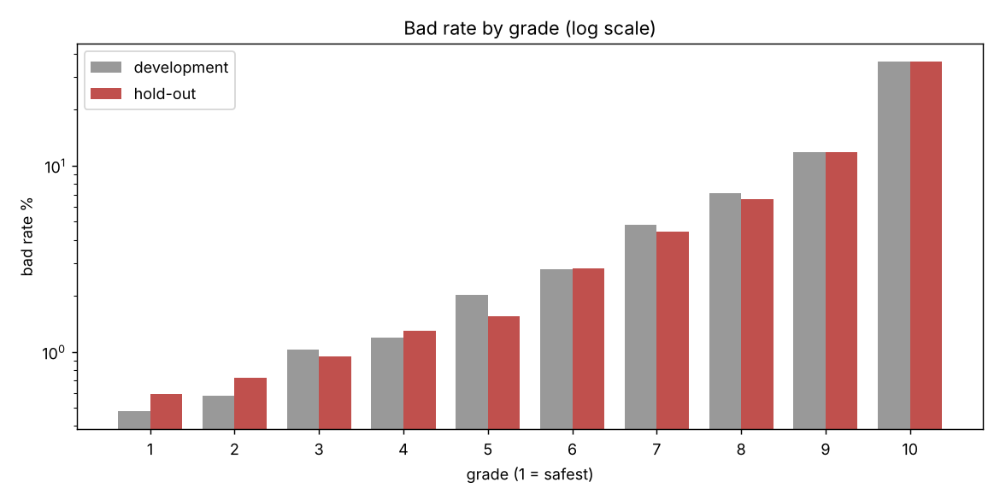
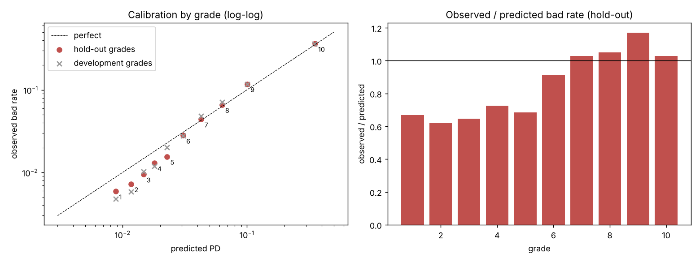

# Credit Risk PD Scorecard (Give Me Some Credit)

An application scorecard for the **probability of default (PD)** of retail borrowers, built the way a bank model-development team would:
WoE binning, logistic regression, points-based scorecard, and a validation that separates *ranking* from *calibration*.

> Learning / portfolio project on a public dataset. **Not** a production model; not for real lending decisions.
> Limitations are stated up front in [`reports/limitations.md`](reports/limitations.md).

> [!IMPORTANT]
> **The raw data is not in this repository. Put it in place before running anything.**
> Download `cs-training.csv` from the Kaggle competition [Give Me Some Credit](https://www.kaggle.com/c/GiveMeSomeCredit/data)
> (you must accept the competition rules) and save it **exactly** as:
>
> ```
> credit-risk-pd-model/data/cs-training.csv
> ```
>
> Every notebook reads it from that path (`../data/cs-training.csv`, relative to `notebooks/`).
> Notebook 02 then creates `data/processed/` automatically. See [How to reproduce](#how-to-reproduce).

## Results (hold-out set, 45,012 customers, 3,006 bad)

| Check | Result |
|---|---|
| AUC / Gini / KS | **0.860** (95% CI 0.852-0.867) / **0.719** / **0.565** |
| Development AUC / Gini / KS | 0.858 / 0.717 / 0.554 (5-fold CV AUC 0.858 +/- 0.008), so no overfitting |
| Rank ordering | bad rate rises strictly over 10 grades, **0.5% to 36%**, on both sets |
| Calibration, overall | mean PD 6.64% versus 6.68% observed; calibration slope 0.98 |
| Calibration, by grade | **safest five grades are over-predicted (observed / predicted about 0.6-0.7)**; structural; Hosmer-Lemeshow rejects |
| Remedy | grade master scale (PD per grade from development) repairs grade-level calibration; linear recalibration does not |
| Stability | score PSI 0.0005 (random split, so not informative about time) |
| Example cut-off | score >= 560 approves 79.5% of applicants at a 2.3% bad rate (6.7% without the scorecard) |

No class weights and no SMOTE are used, so the model output remains a real PD.




## What was built

| Step | Notebook | Content |
|---|---|---|
| 1 | `01_data_understanding` | structure, target definition (90+ days past due within 2 years), anomalies, target-free |
| 2 | `02_train_holdout_split` | 70/30 stratified, duplicate-aware split of the raw data, seed 42 |
| 3 | `03_data_quality_cleaning` | evidence on the development set only, six deterministic cleaning rules, no imputation |
| 4 | `04_woe_iv_binning` | coarse classing with business-driven monotonic WoE, Information Value, stability checks |
| 5 | `05_variable_selection_logit` | IV, correlation, VIF, signs, p-values, backward elimination, `statsmodels` logit (9 variables) |
| 6 | `06_pd_scorecard` | PDO scaling (600 points at odds 50:1, PDO 20), points per bin, hand checks |
| 7 | `07_model_validation` | hold-out AUC/Gini/KS with bootstrap CI, rank ordering, calibration, master scale, PSI/CSI, cut-off table |

Logic lives in `src/` and is unit tested (`pytest tests`); notebooks call it and carry the narrative.

## Key design decisions

- **Split first, then explore.** Cleaning thresholds are justified on the development set only, and one deterministic `clean()` is applied to both sets, so nothing leaks into the hold-out.
- **No imputation.** Missing or invalid values get their own WoE bin; special codes (96/98) and absolute amounts hidden in `debt_ratio` are handled explicitly.
- **Business-driven monotonicity** of WoE (with one deliberate exception, `n_real_estate`, where a U-shape is meaningful).
- **Honest reporting.** Where the model is weak (grade-level calibration) or where a choice was influenced by seeing data, the reports say so.

## Repository structure

```
credit-risk-pd-model/
├── data/                  # put cs-training.csv here (not committed; see data/README.md)
│   └── processed/         # created by notebook 02 (not committed)
├── notebooks/             # 01 ... 07, executed with outputs
├── src/                   # data_processing, feature_engineering, modeling, scorecard, evaluation
├── tests/                 # unit tests (binning, selection, scorecard, metrics)
├── outputs/
│   ├── figures/
│   ├── metrics/           # cleaning logs, IV, selection log, validation tables
│   └── scorecard/         # binning_spec.json, model_spec.json, scorecard_points.csv, grade_master_scale.csv
├── reports/
│   ├── model_development.md
│   ├── model_validation.md
│   └── limitations.md
├── requirements.txt
└── README.md
```

## How to reproduce

1. Get the data from Kaggle ("Give Me Some Credit"; you must accept the competition rules) and save it as **`data/cs-training.csv`** (see the note at the top).
2. `pip install -r requirements.txt` (Python 3.13; versions are pinned to the ones that produced the committed outputs)
3. Run the notebooks **in order** from the `notebooks/` folder (they use relative paths):
   ```
   cd notebooks
   jupyter nbconvert --to notebook --execute --inplace 0*.ipynb
   ```
   A full run takes about one minute and regenerates `data/processed/` and everything in `outputs/`.
4. From the repository root: `pytest tests`

## Main limitations (full list in `reports/limitations.md`)

- **No dates, so no out-of-time validation.** Random split only; performance over time is unknown.
- **Only approved customers** (no reject inference).
- **Dated US data**; nothing here describes Vietnamese borrowers or products.
- Four variables have IV above 0.5; plausible for bureau behaviour, but field timing cannot be verified without dates.
- Same person developed and validated; no fairness or legal review (note that `age` is a predictor).

## Roadmap

1. XGBoost challenger on the same split and metrics, SHAP, sensitivity checks (seeds, duplicates, bin settings).
2. Repeat the core on Lending Club with out-of-time validation, PSI/CSI over time and a monitoring run.
